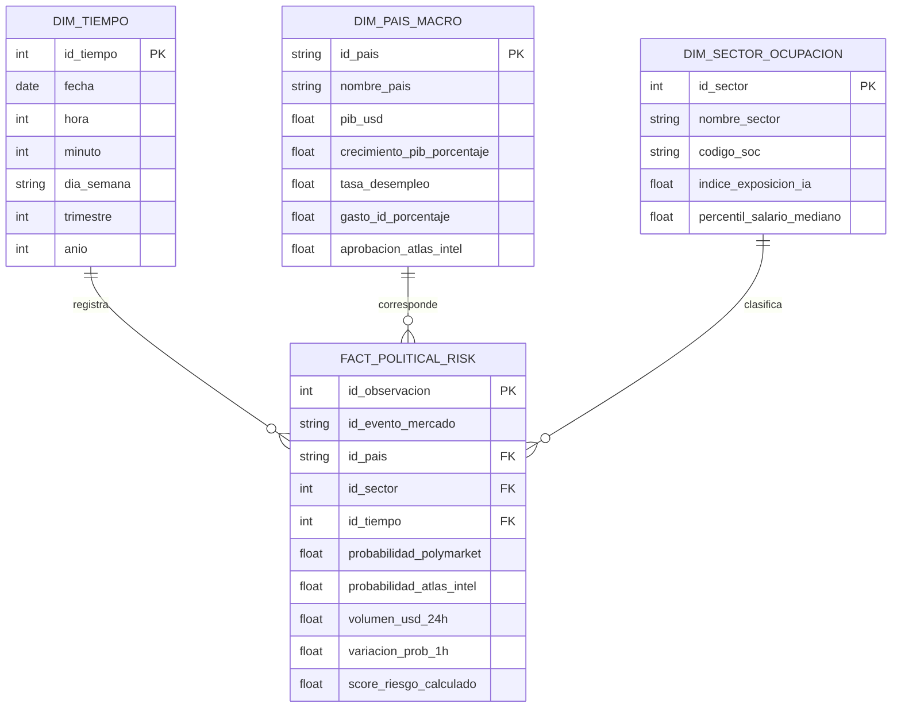
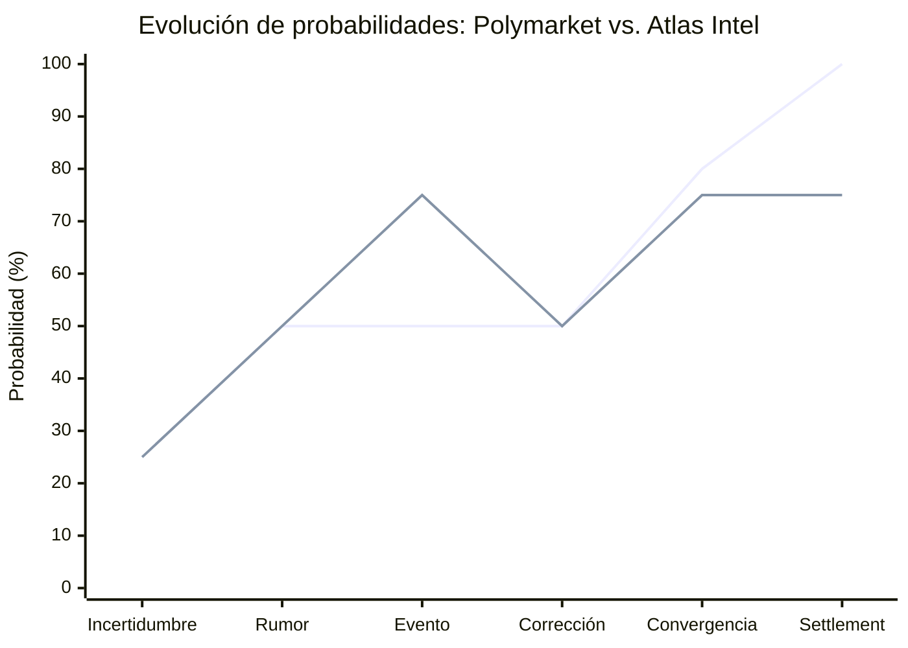

<h1>Invetigación: Plataforma financiera y predicción de riesgo político</h1>

## Necesidad de negocio 
#### Contexto
> Un fondo de inversión gestiona un portafolio diversificado: renta variable, bonos soberanos, materia prima, activos tecnológicos.

#### Áreas involucradas
> - Gerencia de riesgos
> - Mesa de operaciones
> - Equipo de investigación económica
> - Comité de inversiones

#### Problema actual
> Las decisiones de inversión frente a eventos políticos, desde elecciones o aprobaciones de leyes hasta regulaciones tecnológicas (por ejemplo, de IA) o cambios de tasas de interés, dependen altamente de encuestas tradicionales o reportes de consultoría política. Pero esta metodología presenta limitaciones: \
> - _Alta latencia._ 
> - _Sesgo de respuesta_ (desfase entre opinión declarada y comportamiento real). 
> - _Incapacidad de reacción_ (imposible ajustarse en tiempo real ante eventos de gran e inmediato impacto). 

#### Objetivo 
> Desarrollar una plataforma de Big Data que procese el flujo en tiempo real de mercados de predicción (Prediction Markets) y los relacione con indicadores socioeconómicos estructurales y la adopción de tecnologías estratégicas. La plataforma construirá un Índice Dinámico de Riesgo Político y Regulatorio (IDR-PR) para guiar la asignación de activos y la estrategia de cobertura en tiempo real.

#### Beneficios esperados
> 1. Optimización de coberturas (_hedging_), que se traduce en reducir las pérdidas de capital durante eventos de alta volatilidad política (por ejemplo, elecciones).
> 2. Anticiparse a cambios en la cotización de activos mediante la detección temprana de desplazamientos de probabilidad en eventos políticos clave (por ejemplo, regulaciones).
> 3. Automatizar procesamientos tradicionalmente manuales, que se traduce en reducción de falibilidad y tiempo (y, probablemente, empleados).

#### Evaluación de éxito
> El éxito de la propuesta se evaluaría de varias maneras, yendo de la validación técnica en desarrollo hasta el impacto económico, pasando por el rendimiento en producción:
> - **MLflow**
>   - **Registro y comparación de runs:** seguimiento continuo de parámetros, hiperparámetros y artefactos durante la etapa de experimentación.
>   - **Métricas de Aprobación (Gatekeepers):** para que un modelo sea promovido al estado `Production` en el **MLflow Model Registry**, debe alcanzar de manera consistente un **AUC-ROC > 0.82** y un **Brier Score < 0.15**.
> - **Desempeño y Observabilidad en Producción:**
>   - **Control de Drift:** seguimiento de *Data Drift* y *Concept Drift*.
>   - **Latencia:** alertas recalculadas en menos de 5 minutos tras cambios ≥ 5% en probabilidades clave.

## Datos 
#### Fuentes y características

| Fuente de datos | Tipo y formato | Volumen estimado | Frecuencia de llegada |
|---|---|---|---|
| **Polymarket Data** (`SII-WANGZJ/Polymarket_data`) | (semi)estructurado (JSON / Parquet) | ~15 GB por día (~2M tx) | Event-driven (Websockets) |
| **Atlas Intel Polls Data** (API / Web scraping de microdatos RDR) | (semi)estructurado (JSON / CSV) | ~2 GB (Histórico y microdatos) | Diaria / Eventual |
| **World Bank Indicators** (`ContextNews/world-bank-indicators`) | Estructurado (Parquet / CSV) | ~500 MB (Histórico) | Anual / Trimestral |
| **Anthropic Economic Index** (`Anthropic/EconomicIndex`) | (semi)estructurado (JSON / Parquet) | ~2 GB (Procesado) | Mensual / Semanal |
| **Global Skill & Salary Percentile** (`harshitkz/skill-salary-percentiles-global`) | Estructurado (CSV) | ~1 GB (Estático) | Semestral |

#### Datos disponibles vs. supuestos estimados
> - **Datos Disponibles (Observados):**
>   - Histórico de precios, volúmenes y transacciones ejecutadas en Polymarket.
>   - Encuestas de alta frecuencia e intención de voto geolocalizada de Atlas Intel.
>   - Series históricas consolidadas del Banco Mundial y distribución de percentiles salariales globales.
> - **Supuestos Estimados (Identificados para la Arquitectura):**
>   - _Tasa de crecimiento de volumen:_ incremento del 200% anual en el volumen transaccionado de mercados de predicción durante períodos electorales globales.
>   - _Latencia de red API:_ latencia promedio de ingesta vía WebSockets/REST de 250 milisegundos desde la red Polygon.

#### Sensibilidad, calidad y restricciones
> - **Sensibilidad:** los datos corporativos e indicadores de portafolio son de alta sensibilidad comercial y deben protegerse mediante encriptación en reposo (AES-256) y en tránsito (TLS 1.3).
> - **Calidad de Datos:** riesgo de mercados ilíquidos o manipulación en Polymarket. Se requiere la aplicación de filtros de liquidez mínima (operaciones > USD $50.000) en la capa de transformación.
> - **Restricciones:** límites de tasa (Rate Limits) en APIs públicas y necesidad de estandarización de códigos geopolíticos (ISO-3) y ocupacionales (SOC) entre fuentes.

## 3. Arquitectura propuesta

#### Recorrido de los datos (Capa por capa - Medallion Architecture)
> 1. **Ingesta (Streaming & Batch):**
>    - _Streaming:_ Apache Kafka / Databricks Auto Loader consumiendo datos *event-driven* desde los WebSockets de Polymarket.
>    - _Batch:_ DAGs programados en Apache Airflow descargando datasets de Atlas Intel, Hugging Face y Banco Mundial via API/REST.
> 2. **Capa Bronze (Raw Data):**
>    - Almacenamiento en AWS S3 en formato Delta Lake nativo. Persistencia *Append-only* agregando metadatos de auditoría (`_ingested_at`, `_source_file`).
> 3. **Capa Silver (Limpieza, Calidad y Enriquecimiento):**
>    - Limpieza y procesamiento distribuido con PySpark en Databricks.
>    - Eliminación de duplicados, tipado explícito, normalización de probabilidades (0.0 a 1.0) y JOIN entre fuentes usando claves ISO-3 y códigos SOC.
> 4. **Capa Gold (Métricas de Negocio y Modelado):**
>    - Construcción del modelo dimensional en estrella (Star Schema) y cálculo continuo del IDR-PR.

#### Selección de tecnologías concretas
> - **Almacenamiento:** AWS S3 + Delta Lake (transacciones ACID, versionado *Time Travel*, compresión Parquet).
> - **Procesamiento / Cómputo:** Databricks (Apache Spark) para procesamiento masivo distribuido.
> - **Orquestación:** Apache Airflow para gestión de dependencias y flujos batch.
> - **Calidad de Datos:** Great Expectations integrado en la capa Silver para validación automática de esquemas y rangos.
> - **Gobierno y Catálogo:** Unity Catalog (Databricks) para control de acceso granular (RBAC) y linaje del dato.
> - **Visualización:** Power BI / Databricks SQL Dashboards mediante DirectQuery conectado a la capa Gold.

#### Diagrama de arquitectura

```mermaid
flowchart LR

    subgraph FUENTES["1. FUENTES DE DATOS"]
        direction TB
        P["API de Polymarket / Webhooks"]
        A["Atlas Intel / Banco Mundial / Anthropic"]
        S["Skill Salaries (CSV / Kaggle)"]
    end

    subgraph INGESTA["2. INGESTA"]
        direction TB
        K["Kafka<br/>Procesamiento en flujo"]
        E["Extractores en Python<br/>Procesamiento por lotes"]
    end

    subgraph LAKE["3. ARQUITECTURA LAKEHOUSE (S3 + DELTA LAKE)"]
        direction TB
        B["BRONCE<br/>Tablas Delta sin procesar<br/>Solo anexado"]
        SI["PLATA<br/>Limpieza, estandarización,<br/>validación y resolución de entidades"]
        G["ORO<br/>Agregaciones de negocio<br/>Modelos analíticos"]

        B -->|"Spark / PySpark"| SI
        SI -->|"SQL / PySpark"| G
    end

    subgraph BI["4. CONSUMO ANALÍTICO"]
        direction TB
        SQL["Consultas SQL"]
        POWER["Power BI / Tableau"]
        SQL --> POWER
    end

    subgraph MLOPS["5. APRENDIZAJE AUTOMÁTICO / MLOPS"]
        direction TB
        FS["Almacén de características<br/>(Feature Store)"]
        TRAIN["Entrenamiento de modelos"]
        MLF["MLflow<br/>Seguimiento de experimentos<br/>y registro de modelos"]
        SERVE["Servicio de modelos<br/>API de inferencia"]

        FS --> TRAIN
        TRAIN --> MLF
        MLF --> SERVE
    end

    subgraph ORQ["ORQUESTACIÓN"]
        AF["Apache Airflow<br/>Programación y supervisión<br/>de flujos de trabajo"]
    end

    P -->|"Eventos"| K
    A -->|"Extracción mediante API"| E
    S -->|"Lectura de archivos"| E

    K --> B
    E --> B

    G --> SQL

    SI --> FS
    G --> FS

    SERVE -.->|"Predicciones"| POWER

    AF -.->|"Coordina"| E
    AF -.->|"Coordina"| SI
    AF -.->|"Coordina"| G
    AF -.->|"Coordina"| TRAIN

    style B fill:#cd7f32,color:#fff,stroke:#8b5a2b
    style SI fill:#c0c0c0,color:#000,stroke:#808080
    style G fill:#d4af37,color:#000,stroke:#997a00
    style FS fill:#3979a8,color:#fff,stroke:#245477
    style MLF fill:#6b5b95,color:#fff,stroke:#483d8b
    style SERVE fill:#6b5b95,color:#fff,stroke:#483d8b
```

## 4. Modelado de datos

#### Estructura del modelo dimensional (Star Schema - Capa Gold)

## 5. Justificación

#### Tabla de decisiones técnicas y compromisos

| Dimensión | Decisión Adoptada | Fundamento Teórico / Técnico | Compromisos y Limitaciones |
|---|---|---|---|
| **Escala y Cómputo** | Apache Spark / Databricks | Escalabilidad horizontal para millones de eventos diarios sin saturar memoria. | Mayor costo operativo de clústeres si no se aplica *auto-termination*. |
| **Almacenamiento** | Delta Lake (Parquet + ACID Log) | Permite viajes en el tiempo (*time travel*), control transaccional e indexación Z-Ordering. | Requiere mantenimiento periódico (*VACUUM* / *OPTIMIZE*). |
| **Latencia** | Streaming híbrido (Kafka + Airflow) | Inmediatez sub-segundo para datos de mercado combinada con eficiencia de costo para datos macro batch. | Mayor complejidad de diseño al mantener dos vías de ingesta. |
| **Gobierno y Seguridad** | Unity Catalog / Great Expectations | Garantiza control RBAC por celda/columna y evita el ingreso de registros con esquemas corruptos. | Sobrecarga administrativa inicial en la definición de políticas de gobierno. |

## 6. Gráficos y diagramas explicativos

#### Gráfico 1: Dinámica Teórica del Mercado de Predicción vs. Encuestas Atlas Intel

#### Gráfico 2: Matriz de Riesgo Regulatorio por Sector (Estimada)
| Exposición a IA / Impacto político | Bajo impacto político | Alto impacto político |
|:---|:---:|:---:|
| **Alta exposición a IA** | **Finanzas** Riesgo moderado | **Software / IA** Riesgo crítico (IDR-PR > 80) |
| **Baja exposición a IA** | **Manufactura** Riesgo bajo | **Energía** Riesgo moderado |

